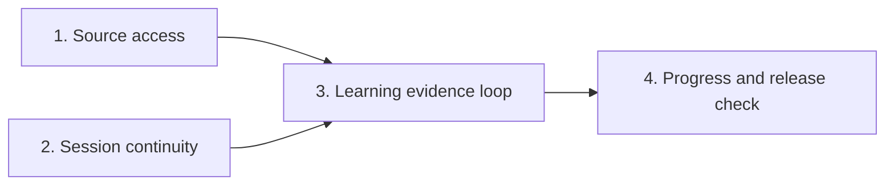

# OPERA learning system MVP plan

Status: proposed for review. No application changes are authorized by this plan.

## Goal and MVP boundary

Make the existing tutor dependable for one complete path: select a local lesson, read a bounded and cited section, learn one objective, submit one answer, receive feedback, resume the same subject, and inspect evidence in the browser dashboard. Keep the current terminal interface and Pi session history.

**MVP passes when:** a user can complete that path with both a text PDF and an image-only PDF; a subject switch does not leak the prior subject's topic or source; the dashboard shows the recorded attempt without implying mastery. Every step must work after restarting OPERA. The image-only path requires Poppler's `pdftoppm` and a vision-capable model; absence of either must yield a clear instruction, never a fabricated citation.

Existing capabilities are starting points, not work to rebuild. `/learn`, `/review`, `/opera`, five tools, 100 MB local source cap, numbered PDF reads, session topic mapping, checkpoints, and an offline HTML dashboard are present. Baseline on 2026-10-31: `npm.cmd test` passed 108 tests with one Windows symlink test skipped; `npm.cmd run check` passed. The selected JLPT file is not in this repository, so the plan uses test fixtures and a final user-file check when available.

## Requirements and constraints

1. Teach from the selected source when claiming source support. Cite physical PDF pages, PPTX slides, text lines, or video timestamps. Mark unsupported claims as general explanation.
2. Keep reads bounded: PDFs at most three pages per call, local sources at most 100 MiB, and existing image, text, XML, and video extraction limits. Do not load an entire large PDF into model context.
3. Preserve actual learner responses, assistance, answer exposure, checkpoints, and original grades. A skip or tool failure is not an incorrect answer. Only one unresolved question is active.
4. Resuming Pi session A restores A's topic, checkpoint, and relevant source after studying session B. Unknown legacy sessions must not inherit B's topic by accident.
5. `/opera → Progress` opens a readable browser snapshot showing topic activity and evidence. Counts describe attempts, not mastery. Keep terminal fallback information when browser launch fails.
6. Preserve `.opera`, `Learning`, Pi history, and provider configuration during updates. No new account, server, framework, or automatic course generation.

## Current architecture and simplest stack

| Layer | Current component | MVP decision |
|---|---|---|
| Runtime and commands | Node.js 22.19+, Pi 1.4.0, `opera.mjs`, `.pi/extensions/opera/index.ts` | Keep one extension and three commands. |
| Teaching rules | `AGENTS.md` and focused `.pi/skills/learning-system` references | Keep one authoritative contract; load only relevant references. |
| State and evidence | `.pi/extensions/opera/lib/store.mjs`, `.opera/state.json`, Pi session history | Keep version 1 state, atomic writes, backup, and session topic mapping. |
| Source readers | `sources.mjs`, `pptx.mjs`, `video.mjs` | Keep local bounded reads. Use `pdftotext` for text PDFs and `pdftoppm` for scanned page images. |
| Progress UI | `insights.mjs` writes `Learning/Dashboard.html` | Keep static offline HTML and CSS. No dashboard framework or service. |
| Verification | Node test runner, TypeScript, Playwright Core for browser tests | Extend focused tests and run existing suite. |

Runtime dependencies already declared: Pi packages, TypeBox, fflate, xmldom, FFmpeg, and FFprobe. `pdftotext` is available through Git for Windows on this machine. `pdftoppm` and `pdfinfo` are not present here; `pdfinfo` is optional. A vision-capable model is needed to interpret scanned page images. Do not add OCR, a database, or a second web app for this MVP.

## Delivery order

### Milestone 1 — Reliable bounded lesson access

**Scope and user behavior:** Make the current PDF path work end to end on the target Windows installation. A text PDF returns page-numbered text. An image-only page returns a numbered image to a vision-capable model. If `pdftoppm` or vision input is unavailable, OPERA requests a page screenshot or OCR export and does not send an unreadable image to a text-only model. Retain the 100 MiB file cap and other extraction bounds. Use synthetic fixtures; do not copy the private JLPT book into the repository.

**Acceptance criteria and tests:**

- A valid PDF padded to exactly 100 MiB is accepted; the same fixture at 100 MiB plus one byte is rejected with the stated limit. Reading requests remain limited to one to three physical pages.
- Text PDF fixture returns the requested page number and extractable Japanese text. Image-only fixture returns an image block tagged with the requested physical page number.
- A text-only model, missing `pdftoppm`, damaged PDF, and out-of-range page each produce an actionable result. Out-of-range detection works even if optional `pdfinfo` is missing. No result claims to have read a page it could not access.
- A scripted tutor check cites only pages returned by `opera_source`. Unsupported explanations are labeled as such.

**Depends on:** current source registration and reader. No earlier milestone.

**Run and verify:** `npm.cmd run check`; `node --test tests/pdf-source.test.mjs tests/extension.test.mjs`; run a manual read of one text fixture and one image-only fixture on the target machine. Confirm `pdftoppm` availability with `Get-Command pdftoppm`. If absent, follow the documented Poppler setup, then repeat the image-only check.

### Milestone 2 — Session-safe continuation

**Scope and user behavior:** Finish isolation of topic, checkpoint, selected source, and pending work by Pi session. Bind the selected source to the session when it changes, including after a checkpoint. After switching subjects, `/learn` with no argument and `/opera → Resume` continue the resumed session. A new session with no known topic asks for one instead of inheriting another session's topic.

**Acceptance criteria and tests:**

- Create sessions A (Japanese N3) and B (another subject). Give each a different source and checkpoint, then change A's source without saving another checkpoint. Resume A, then B; each shows its own topic, latest source, and next action.
- Restart OPERA and repeat the switch. A pending answer in A remains pending only in A; no new question is generated before feedback.
- A legacy session with an identifiable prior `/learn` prompt or captured attempt restores its topic. If no reliable match exists, OPERA asks for a topic and leaves the previous subject inactive.
- Existing attempt IDs, grades, source roots, and Pi history stay unchanged through switching.

**Depends on:** current source registration and session state. Independent of milestone 1; Markdown fixtures suffice for the source-switch test.

**Run and verify:** `node --test tests/extension.test.mjs tests/lean.test.mjs tests/core.test.mjs`; manually create two Pi sessions, switch with Pi's resume command, and inspect `/learn` plus `/opera → Resume` in each. Compare `.opera/state.json` before and after to confirm additive session metadata only.

### Milestone 3 — One objective, one answer, grounded feedback

**Scope and user behavior:** Verify the existing teaching path as one vertical slice. The tutor chooses a small objective from an accessible page, explains it, asks at most one fair question, records the learner's actual response, gives precise feedback, and waits. `/review` later uses observed weak or due evidence with changed wording.

**Acceptance criteria and tests:**

- A scripted source-grounded Japanese lesson names one objective and cites the read page. It never presents a claim as sourced when page access failed. Manual transcript checklist: one objective, one physical page citation matching the tool result, zero invented page citations, and zero extra questions after feedback.
- A submitted answer creates exactly one attempt ID. Assessment uses that ID and records the original response, assistance, verdict, and feedback. Reassessment cannot silently overwrite the grade.
- Hint, shown answer, `idk`, skip, cancellation, and technical failure remain distinct. None creates independent correct evidence without an independent answer.
- After feedback, the tutor stops until the learner says `next` or equivalent. Review asks a changed question on an observed target; a completion count is never called mastery.

**Depends on:** milestones 1 and 2, because lesson evidence must follow the accessible source and active session.

**Run and verify:** `node --test tests/activities.test.mjs tests/core.test.mjs tests/extension.test.mjs tests/lean.test.mjs`; run one manual text-PDF lesson and one scanned-page lesson. Inspect `opera_progress inspect` and the saved attempt after each answer.

### Milestone 4 — Progress dashboard and release check

**Scope and user behavior:** Make `/opera → Progress` the clear visual entry point. The offline dashboard shows current topic, next action, counts by topic, pending feedback, unknown capabilities, and expandable attempt evidence. It remains readable at desktop and phone widths. Finish packaging and documentation only after the full learning path passes. `docs/plan.md` is a review artifact, not an application update payload.

**Acceptance criteria and tests:**

- Selecting Progress opens `Learning/Dashboard.html`; the terminal shows a file path if automatic browser launch fails. It does not dump the Markdown report.
- Dashboard totals match stored assessed, independent correct, assisted, and pending attempts for a two-topic fixture. Skips and unassessed attempts do not inflate assessed counts. No mastery percentage appears.
- Japanese text, long responses, and HTML-like learner input render safely. Keyboard navigation works; 375 px viewport has no clipped controls or unreadable chart labels.
- Updating an installation preserves `.opera`, `Learning`, provider settings, and Pi sessions. If application files change, the application manifest includes them and its allowlist accepts their paths. README names the required PDF tools and limits. The full regression suite and type check pass.

**Depends on:** milestones 1–3, so the dashboard reflects verified source, session, and attempt behavior.

**Run and verify:** `npm.cmd test`; `npm.cmd run check`; inspect the browser dashboard with the existing Playwright test and a manual keyboard/phone-width pass. Run the updater against a disposable copy and compare learner/config files before and after. Do not run it against the only live copy for verification.

## Risks and decisions

| Risk | MVP handling |
|---|---|
| `pdftoppm` missing on this Windows machine | Treat as a first-milestone prerequisite. Provide a tested install path and clear runtime check. Never claim scanned pages were read when rendering failed. |
| The actual JLPT PDF is outside the repository | Use generated text and scan fixtures in automation. Run one final read against the user's file only when available; do not commit it. |
| Session state is global in `.opera/state.json` | Bind current topic and source to Pi session ID; use recorded evidence or an exact historical `/learn` prompt for legacy recovery. Unknown history stays unknown. |
| Model output is not fully deterministic | Test tool invariants automatically; use a short scripted manual tutoring check for citation and pause behavior. |
| Large media or untrusted source content | Keep page, size, time, XML, and output caps. Treat source content as data and escape dashboard output. |
| Packaging may overwrite learner data | Use the existing manifest/updater with a disposable-copy preservation test. |

## Out of scope

Automatic OCR text indexing, full-book ingestion, curriculum generation, new quiz modes, scoring or gamification, accounts, cloud sync, a live dashboard server, and a new persistence layer. Reconsider them only after the MVP path passes with real use.

## Review decision

Confirm or revise the four milestones, especially the Poppler prerequisite for scanned PDFs. Implementation starts only after this plan is reviewed.
